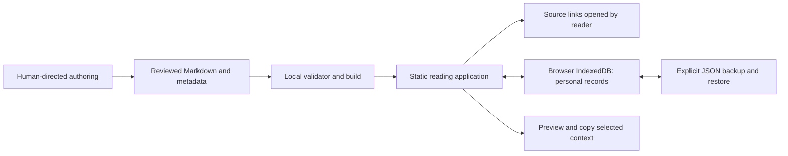

# Local-first architecture

## Decisions

Use React, TypeScript and Vite for a local static web application for survey guidance, paper assistance and research exploration. Interactive source panels, section navigation, selection context and local-record editing justify reusable components; there is no need for SSR, a service database or a framework migration from an older site.

At implementation time choose supported stable compatible releases, record the Node/runtime versions and commit a dependency lockfile only when committing is separately authorized. Do not guess future version numbers. Expected commands after W0: `npm run dev`, `npm run validate:content`, `npm test`, `npm run build`, `npm run preview`, and `npm run test:e2e`. These commands are a delivery contract, not currently present scripts.



## File ownership

```text
content/                 reviewed source bodies, metadata and catalog
schemas/                 package contract
src/content/             catalog loader, validated types and link resolution
src/reader/              prose, table, formula, diagram and source components
src/library/             home/library and search
src/records/             IndexedDB access, note editing, import/export
src/exploration/         editorial paths, personal question/evidence/action loop
src/handoff/             context preview and clipboard fallback
src/styles/              tokens and responsive reading styles
scripts/                 local content validation/import tooling
tests/                   unit, integration, security and browser tests
docs/                    specification and actual delivery evidence
dist/                    generated assets, ignored
```

No files in src/ or scripts/ are supplied yet. Keep modules within this single application, not separate services. Two small boundaries suffice: `ContentRepository` loads read-only reviewed content; `PersonalRecordStore` owns local user records. Do not build a generic plugin framework for hypothetical future storage engines.

## Routing and local origin

Use routes `/`, `/library`, `/read/:guideId/:revision`, `/notes`, `/explore`, `/explore/lenses/:lensId` and `/explore/questions/:explorationId`; a fragment selects a stable unit. Keep the selected revision in the route so citations and notes have an exact context. A missing revision must show a meaningful choice to open the current revision, never silently redirect to different text.

Use the same localhost origin and configured port for normal reading and preview, with strict-port failure rather than silently moving to another port. Ports used by isolated tests have separate storage. File URLs are not the supported launch mode. LAN testing is optional and must be explicitly enabled; bind to loopback by default.

## Personal state

Use IndexedDB with a versioned schema and transactions. No application server or account is required. The content package never includes these records:

- Resume: guideId, revision, unitId, optional block fingerprint, bounded intra-unit offset, updatedAt. Automatic position tracking is not a reading-status change.
- Guide reading state: explicit unread/reading/read/deferred, timestamp and guide revision.
- Original-paper reading state: separately explicit unread/reading/read/deferred, source version and timestamp. Default unknown/unread is not a claim of a person's actual history; distinguish no record from an explicit mark.
- Notes/questions: UUID, guideId/revision/unitId, optional quoted passage and block fingerprint, user-authored text, status open/resolved only by user action, revision number and timestamps.
- Explorations: records and embedded evidence/next actions exactly as defined in EXPLORATION.md. Store them separately from public editorial seeds; UUIDs are locally generated, not source identities.
- Presentation preferences: font size/theme choices only; no inferred background or ability profile.

No state is called mastery. Marking the guide read does not mark the original read; generating a guide, scrolling to the end or copying a question changes neither. If the original source version is unknown, store null rather than guessing.

Note and exploration updates use an expected record revision in a read-modify-write transaction. Two tabs editing the same note or exploration must preserve both drafts and offer a conflict choice; do not use client timestamp as a winner. Resume position may use latest interaction, but it cannot replace note text. A failed save keeps the editor buffer visible and offers copy/export recovery; show Saved only after successful persistence/read-back.

Content updates never rewrite personal records. Keep the referenced old revision, or show the old quotation and an unresolved-anchor state. An exact unique text match can be offered for confirmation; no silent fuzzy relocation. Content rollback is independent of notes, explorations and guide/original reading marks. Removing a note or an unavailable content target must not cascade-delete an exploration or its saved quotation. Evidence shows unavailable linkage while keeping provenance and text.

## Backup and import

Personal backup JSON v1 has `format: paperdesk-personal-backup`, `schemaVersion: 1`, `exportedAt` in UTC and arrays named resume, guideStates, originalStates, notes and explorations, plus a preferences object. Exploration evidence and nextAction are embedded in each exploration, so they export atomically. The implementation must supply a strict backup schema and migration policy before persistence ships; unknown fields/unsupported versions fail rather than disappearing. Validate evidence by provenance: guide quotes require pinned guides, independent original excerpts require source identity/locator, and reader observations may legitimately have neither. Preserve these distinctions through export/import. It contains only intentional personal records and preferences, no browser identifiers or machine paths. Export is a download initiated by the user, not an upload. Explain that the file can contain private text.

Import validates size/schema/IDs before showing counts, duplicates, unavailable content revisions and conflicts. Use a transaction: identical id+revision+body is skipped; higher revision is not silently accepted over local changes; different content under the same ID preserves both versions until chosen. Cancel changes nothing; malformed or newer unsupported schema changes nothing. Preserve unmapped notes and exploration evidence with their old IDs and quotes. Check cross-record references without dropping missing-link snapshots; record conflicts include embedded evidence and next actions. Never merge imported content into the read-only article files. Provide explicit local-data removal with confirmation and a backup option.

Browser storage can be evicted or cleared. Persistence requests may fail and are not backup. Changing host/protocol/port creates a different origin; migration requires export/import. V1 has no device synchronization and no offline availability promise.

## Content continuation

ContentRepository owns the guide catalog and the public exploration seed. Both are read-only at runtime; local CLI updates use the validation/preview/apply contract in MAINTENANCE.md. A seed references exact guide revisions/units; resolve current editorial lens routes from the active seed, while saved seed origins refer to retained seed revisions. Adding another guide/lens must not require reader component edits. PROJECT-STATE.md and the operating guide keep development independent of conversation memory.

## Dependencies and security

Use react-markdown with raw HTML disabled and a product URL allowlist. KaTeX uses `trust: false`, bounded expansion/size and isolated macro state. Handle wide equations in their own region. Mermaid is lazy-loaded locally under the content rules; review generated SVG or use its sandbox mode if the chosen integration cannot safely enforce the stricter subset. No remote fonts, analytics, trackers, CDN scripts or model keys in the client.

Validate imported strings before display, render user text as text, and test malicious URLs/HTML/diagram directives. Use `noopener noreferrer` for external windows; do not send the selected passage or private note in a URL query. A minimal CSP should allow only the local resources actually needed; it does not replace sanitization. Test that opening a source is the only intentional outbound reading request.
