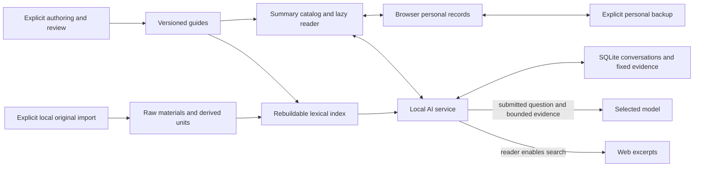

# Local-first architecture

The research extension retains these boundaries: Exploration is the current state in IndexedDB layout 3; SQLite layout 3 stores guide/exploration conversation scopes and per-turn fixed snapshots. Personal archive v3 includes embedded research artifacts/tasks/receipts; AI backup v4 includes actual research context/proposals. The older layout and backup numbers below describe the reading-upgrade baseline. Shared data contracts live in `shared/research-contract.mjs` and `shared/research-artifacts.mjs`; no additional server, vector store or cloud service was introduced. See [research contracts](RESEARCH-CONTRACTS.md).

PaperDesk is a React/TypeScript/Vite reader with an optional local Node AI service. The original static-reader decision remains valid for reading, notes and exploration; the subsequent AI extension adds SQLite conversations, provider adapters and explicit local original-paper ingestion. No hosted account system, synchronization, deployment or automatic content-production service is part of this architecture.

## Boundaries and files

```text
content/                 reviewed immutable Markdown, metadata, assets and catalog
schemas/                 strict content, record and original-material contracts
src/app/                 application shell and navigation
src/content/             summary catalog, on-demand guide loading and bounded cache
src/reader/              prose, tables, formulas, diagrams, locators and selection
src/library/             overview and local title/topic filtering
src/records/             IndexedDB records, editing, v1/v2 personal backups
src/exploration/         editorial lenses and personal evidence/action loop
src/handoff/             explicit context preview and clipboard fallback
src/assistant/           AI panel, paginated history and API client
server/http/             browser request checks, endpoints and network transport
server/ai/               question lifecycle, instructions and provider adapters
server/content/          content validation/import, original materials and retrieval
server/storage/          AI conversation persistence and backup
shared/                  browser-safe content rules and pure package-path rules
scripts/                 thin dev, content-maintenance and benchmark commands
private/reading/         original bytes, manifests, derived units, evidence and index
private/ai/              AI SQLite and separately protected provider credentials
schemas/ tests/ docs/    contracts, verification and recorded evidence
```

This is one project with one package manifest. `scripts/` contains command entry points; reusable validation and import logic lives with backend content code. Frontend code imports browser-safe rules from `shared/`, without importing Node tools. The configuration loader and `server/config.local.json` remain at the backend root; the runtime data locations do not move with source modules. See the [learning path](../learning/README.md) for a guided request trace.

`private/` and backend configuration are never frontend assets. The unified launcher supervises the frontend and backend; port acquisition precedes opening private databases so a second backend cannot recover a live turn as interrupted.



The application and CLI scripts now exist; the earlier W0 statement that these files/commands were only a delivery contract is historical. Use the current scripts in `package.json` and [operations](OPERATIONS.md), not archived preparation gates.

## Content identity and loading

Routes pin `/read/:guideId/:revision#unit`. Missing revisions never silently redirect to newer text. Metadata and body hashes identify an immutable revision; imports keep retained revisions and reject changed bytes under an existing identity. Content changes do not rewrite personal quotations, notes or reading status.

`ContentRepository` initially exposes summaries and fetches the selected metadata/body on demand, checks hashes and bounds response sizes. URL-only imports keep article bodies separate from the initial JavaScript. A cache is bounded to eight guides/4 MiB, pending fetches support cancellation, and loading/error/retry states preserve the selected version. Library filtering and recommendations use summaries; opening a guide never means reading or mastering its original.

The backend keeps canonical guides and original manifests separate from the index. Imported HTML is parsed as data; raw active HTML does not run in the application origin. Original identity includes paper/source revision, material SHA-256, parser revision, source unit and locator. PDF physical pages are distinct from printed labels, which may be unknown. Parsed units remain `partial`/`unreviewed` unless a scoped evidence record says what was checked; figure captions are not image inspection.

`ContentIndex` publishes immutable directory/index generations. A question fixes its generation; later import/reindex affects subsequent questions, not that question's tool reads. Evidence records bind guide revision/unit to original parser/unit and remain authoritative files independent of the index. Rebuilding the index must not erase original bytes, evidence reviews or saved conversation source snapshots.

Retrieval is SQLite FTS5 with lexical-v4 Chinese/English aliases and bounded candidates, not vector/semantic retrieval or exhaustive literature search. The current 30-question development set measured 33/46 required units for original Chinese queries and 44/46 for predeclared English queries; the former misses the proposed 90% goal. This is candidate retrieval, not real-model answer/citation validation. See [independent review](../research/reading-upgrade-independent-review.md).

## Three storage domains

**Browser records:** IndexedDB database name `paperdesk-personal-v1`, layout version 3. Separate intentional record stores, incremental byte/count metadata, cursor indexes, migration recovery and backup staging. The live-data cap is 512 MiB with independent record/field bounds. Hot saves validate only changed records and adjust counters transactionally; they do not rebuild a full backup. Notes/explorations use expected revisions and preserve conflicts/drafts. Reading positions are independent from explicit guide/original marks. See [records](RECORDS.md).

**AI conversations:** SQLite layout version 3 retains full turn/source snapshots plus byte/reservation counters and compact `summary_json`. Indexed cursor queries return conversation pages and at most 100 compact turn previews; a full turn is fetched deliberately. The latest six completed turns provide bounded conversation context. Checkpoints update the active row and counters rather than snapshotting history. One active request per conversation, two service-wide, with request idempotency, cancellations and recoverable terminal states. Default live-data capacity is 512 MiB and default low-disk reserve is 32 MiB; the old 16 MiB value limits legacy JSON transport only. These logical counters do not measure all SQLite/index/WAL/temp-file bytes.

**Original materials:** `private/reading/{materials,manifests,derived,evidence}` holds authoritative public-source inputs and scoped review records. `jobs` records ingestion state; `index.sqlite` is rebuildable. CLI ingestion/reindex is explicit and uses already acquired local files, without model calls or an automated browsing pipeline. Materials have their own directory backup; AI and browser backups do not include them.

## Backups, migration and failure

Personal v1 JSON remains bounded to 5 MiB; v3 NDJSON chunks support larger and research-containing collections (old v2 archives remain importable) with checksums, a snapshot revision, staging and atomic conflict-aware restore. IDB v1 migration retains original rows; downgrade uses an exported pre-upgrade v1 backup on a fresh origin, after separately preserving new records. The browser exporter uses bounded JSON strings and a full downloadable Blob, so browser Blob backing/quota and snapshot space still matter; this is not a guarantee of constant total memory.

AI v3/v4 NDJSON exports iterate a consistent temporary SQLite snapshot. A manifest, sequenced records and final SHA-256/counts close the stream. Imports stage in a separate SQLite database, validate all references and then commit once to live storage; duplicate conversation/turn/request IDs reject the entire import. v1/v2 legacy JSON remains importable within 16 MiB. A v1 layout migration creates an integrity-checked pre-v2 SQLite copy; v2→v3 similarly retains a checked pre-v3 copy. Research conversations select backup v4; otherwise exports remain v3. Downgrade restores that copy separately; never edit `user_version` to bypass compatibility.

Materials backups verify raw/derived hashes and evidence references, copy allowed authoritative files to a new staging directory, then rename it to a new destination. Restore also requires a destination that does not exist; neither operation overwrites an existing collection. Indexes, job files, AI records and credentials are excluded. Normal AI/browser transfer cleanup does not guarantee cleanup after a process crash; materials staging directories also remain on cancellation/failure. See the exact cleanup and space limits in [operations](OPERATIONS.md).

## Privacy, budgets and local origin

Use the normal loopback origin `http://127.0.0.1:4173`; AI binds to 4176, isolated browser tests to 4174. Different schemes/hosts/ports have separate browser records. File URLs and implicit port changes are not supported. Internet hosting would require a different security model.

Only reader-submitted questions, selected guide/original evidence and bounded history leave for the chosen provider; private browser notes do not automatically enter prompts. Optional Tavily search sends bounded queries/excerpts only when enabled for that question. Provider credentials stay in the backend. Fallback follows only the exact supported subscription usage-limit signal, with saved source identifiers and remaining tool budget preserved.

Input preflight counts serialized UTF-8 bytes plus framing allowance and reserves configured output space. It is a conservative estimate for byte-level tokenizers, not exact token measurement or a guarantee for arbitrary compatible endpoints. API output uses `max_tokens`; the current ChatGPT adapter reserves output space locally but does not guarantee an exact upstream output-token cap. Evidence exceeding the local budget yields an explicit error rather than silent omission.

Raw HTML stays disabled in guide Markdown; user text is rendered as text. KaTeX and Mermaid remain bounded/local, external links use the allowlist and safe opening behavior, and no remote fonts/analytics/model keys are shipped. Frontend/private-file denial and Host/Origin/token checks protect the local service; they are not internet authentication. Build/tests do not replace source-content, visual or real-model quality review.
