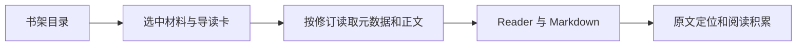
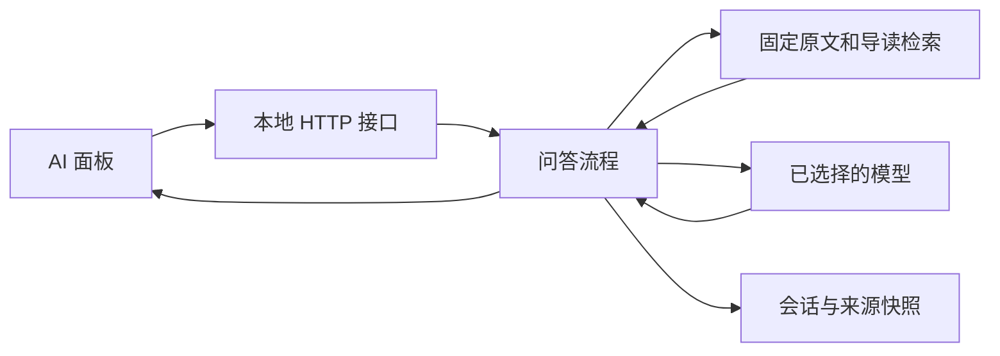

# 从一篇阅读开始学习 PaperDesk

PaperDesk 是一个 React/TypeScript 前端与本地 Node 服务组成的单项目。先运行一次，再沿着“内容怎样显示、问题怎样回答、记录怎样保存”三条路径读代码。无需先读完全部历史文档。

## 1. 启动并认识目录

```text
npm ci
npm run build
npm start
```

网站和本地 AI 服务一起启动，浏览器打开 `http://127.0.0.1:4173/library`。开发时执行 `npm run dev`；停止使用 Ctrl+C。命令都从项目根目录运行，详细参数见[运行说明](../development/OPERATIONS.md)。

| 目录 | 要回答的问题 |
|---|---|
| `src/` | 页面怎样显示，交互怎样改变状态？ |
| `server/` | 请求怎样验证、检索、调用模型并保存？ |
| `shared/` | 哪些纯规则同时被前端、后端和工具使用？ |
| `content/`、`schemas/` | 论文讲解是什么，哪些数据格式可以进入系统？ |
| `scripts/` | 怎样启动、导入和维护内容？ |
| `tests/` | 哪些行为有合成数据和浏览器检查保护？ |
| `docs/` | 当前规范、来源核验和历史决定在哪里？ |
| `private/` | 本地运行数据和凭据；不属于公开源码 |
| `.cache/`、`dist/`、`node_modules/` | 开发产物、构建和依赖；通常无需阅读 |

根目录 [package.json](../../package.json) 是命令入口，[AGENTS](../../AGENTS.md) 是协作边界。项目没有多包工作区；先理解一套启动和构建流程即可。

## 2. 追踪一篇导读

打开书架，选中一篇材料，再进入深度阅读。随后按这个顺序看代码：

1. [main.tsx](../../src/main.tsx) 挂载 React；[App.tsx](../../src/app/App.tsx) 根据路径选择页面，[navigation.tsx](../../src/app/navigation.tsx) 处理站内导航。
2. [Library.tsx](../../src/library/Library.tsx) 用轻量目录筛选材料并展示导读卡。卡片编辑文案来自 `content/library-briefs.json`，与导读修订绑定。
3. [repository.ts](../../src/content/repository.ts) 先提供摘要，在打开某个修订时获取正文与元数据，检查哈希并管理有界缓存。
4. [Reader.tsx](../../src/reader/Reader.tsx) 组织章节、阅读工具与 AI 面板；[Markdown.tsx](../../src/reader/Markdown.tsx) 渲染自然段、引用、公式和教学图。
5. [SourceDialog.tsx](../../src/reader/SourceDialog.tsx) 显示原文版本与定位，退出后返回阅读位置；[Diagram.tsx](../../src/reader/Diagram.tsx) 绘制教学示意。



这里最重要的身份是 `guideId + revision + unitId`。新修订追加而不覆盖旧修订；打开文章或原文不会自动标记已读。完整约定见[内容契约](../content/CONTENT.md)。

## 3. 追踪一次 AI 问答

从 [AiPanel.tsx](../../src/assistant/AiPanel.tsx) 看提交、取消和历史切换，再看同目录的 `api.ts` 怎样向本地后端发请求。面板中的答案与来源展示组件负责渲染，会话状态和请求生命周期保持在一起。

后端从 [server/index.mjs](../../server/index.mjs) 启动。接着读 [HTTP 接口](../../server/http/server.mjs)、[问答流程](../../server/ai/runtime.mjs)、[内容检索](../../server/content/index.mjs)和[会话存储](../../server/storage/ai-store.mjs)。[instructions.mjs](../../server/ai/instructions.mjs)集中定义共享的回答要求、工具和限制，`server/ai/providers/` 负责不同服务的协议适配。可以跟着一个问题观察：请求身份检查 → 固定当前材料 → 组装有界上下文 → 模型及工具调用 → 流式回答与来源快照 → 保存终态。



模型只有在主动提问时才会接收所选材料和有界历史；联网查证单独开启。阅读[AI 阅读契约](../development/AI-READING.md)了解预算、来源和失败恢复，不需要读取本地真实会话或凭据来学习这些代码。

## 4. 分清三类记录

| 类型 | 主要代码与位置 | 设计理由 |
|---|---|---|
| 已审核内容 | `content/`、`src/content/` | 内容可以追加修订，旧引用仍指向原版本 |
| 个人阅读积累 | `src/records/`，浏览器 IndexedDB | 保存笔记、探索、状态与续读，使用独立个人备份 |
| AI 与原文材料 | `server/storage/`、`server/content/`，`private/` | 会话保留回答当时的证据；材料与核验记录独立于可重建索引 |

`src/records/store.ts` 负责 IndexedDB，`archive.ts` 负责个人备份，`hooks.ts` 连接 React。研究探索在 `src/exploration/` 中把问题、证据和下一步连起来。三类备份各有边界，不能用其中一种替代另两种。

## 5. 做一次小修改并验证

可以先选择按钮文案或布局这样容易观察的修改，定位组件后阅读相邻样式和对应检查。运行相关检查，再使用 `npm run build` 确认内容、类型和打包；需要全面回归时执行 `npm test` 与 `npm run test:e2e`。

`tests/unit/` 侧重纯规则，`tests/integration/` 侧重模块协作与存储/服务，`tests/e2e/` 从浏览器检查页面，`tests/smoke/` 保留显式启动及生产检查。测试只使用合成记录；不要为学习复制真实笔记或模型凭据。

改论文讲解时，先读[内容生产工作流](../content/workflows/CONTENT-WORKFLOW.md)与[来源、公式和图示规范](../content/workflows/SOURCES-AND-VISUALS.md)，使用校验和显式导入流程。修改说明不等于有权覆盖已发布正文。

继续了解设计时，读[架构](../development/ARCHITECTURE.md)；需要运行和备份时，读[运行说明](../development/OPERATIONS.md)；了解项目目前能做什么时，读[当前状态](../development/PROJECT-STATE.md)。历史报告留到遇到具体设计问题时再查。
